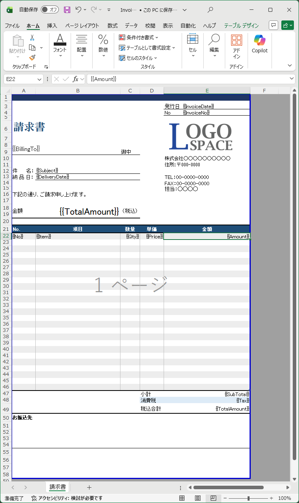
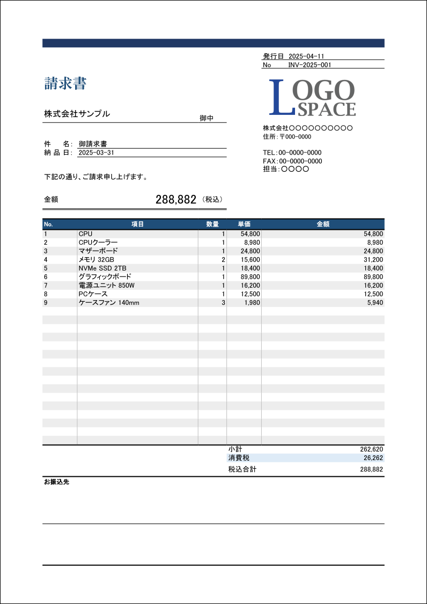

# OysterReport - Excel template to PDF converter

[](https://www.nuget.org/packages/OysterReport/)

## What is this?

A .NET library that converts Excel (.xlsx) templates to PDF.

| Excel |  | PDF |
| :---: | :---: | :---: |
|  | → |  |

## Quick Start

```csharp
var engine = new OysterReportEngine();

using var workbook = new TemplateWorkbook("Invoice.xlsx");
var sheet = workbook.GetSheet("Invoice");

// Replace simple placeholders
sheet.ReplacePlaceholders(new Dictionary<string, string?>
{
    ["CustomerName"] = "UsaUsa Corp",
    ["IssueDate"] = "2025-01-15"
});

// Fill detail rows sequentially from the marker positions
sheet.ReplacePlaceholders(items.Select(static item => new Dictionary<string, string?>
{
    ["ItemName"] = item.Name,
    ["Amount"] = item.Amount.ToString()
}));

using var output = File.Create("invoice.pdf");
engine.GeneratePdf(workbook, output);
```

## Supported features

| Category | Detail |
|---|---|
| **Font** | Size, Bold/Italic/Bold-Italic, Color |
| **Fill** | Background color |
| **Borders** | Border width, Custom color |
| **Text alignment** | Horizontal, Vertical |
| **Merged cells** | Horizontal, Vertical |
| **Images** | Cell-anchored and free-floating |
| **Page setup** | Paper size, Margins |
| **Header / footer** | Header and Footer text |
| **Multi-sheet** | Each sheet |
| **Print area** | Defined print area |
| **Embedded fonts** | Custom font resolver |

## Fonts

Fonts are resolved in this order:

1. `OysterReportEngine.FontResolver`
2. `ReportRenderOption.FontDirectories`
3. OS font directories when `UseSystemFonts` is `true` (default)

Use the same options for `TemplateWorkbook` and `OysterReportEngine`:

```csharp
var options = new ReportRenderOption { FontDirectories = ["/app/fonts"] };
using var workbook = new TemplateWorkbook("Invoice.xlsx", options);
var engine = new OysterReportEngine { RenderingOptions = options };
```

## Images

JPEG, PNG, BMP and GIF are embedded directly. Other formats (e.g. WebP) can be converted to PNG or JPEG by `ReportRenderOption.ImageConverter`.

## Warnings

| Kind | Description |
|---|---|
| `ImageDecodeFailed` | The image could not be decoded and was skipped |
| `MissingGlyph` | Characters not contained in the font |
| `FontEmbeddingRestricted` | The font license restricts embedding |

## Dependencies

- DocumentFormat.OpenXml
